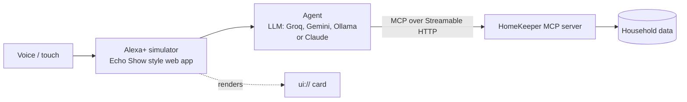

# HomeKeeper for Alexa+

HomeKeeper is an MCP server that lets Alexa+ look after the appliances in a home: AC, fridge, washing machine, water purifier, geyser and microwave.

It remembers what's in the house, when each appliance was bought and serviced, and what the warranty covers. When something breaks, it walks you through the simple fixes first. If you still need a technician, it checks the warranty, quotes the price, books the visit and lets you track it. It can also sell a yearly maintenance plan, and it reminds you when something is due for a service.

> **You:** Alexa, my bedroom AC isn't cooling.
> **Alexa:** Let's try a quick check first. Is the remote on cool mode, with the snowflake icon?
> **You:** Yes, and I cleaned the filter. Still not cooling.
> **Alexa:** A visit is 399 rupees. Your general warranty has ended, but the compressor is still covered until 2030. I can send someone today at 4 or tomorrow at 1.
> **You:** Today at 4.
> **Alexa:** Done. Ramesh will come between 4 and 6. Your visit OTP is 4848.

**Demo video:** _coming soon_

Built for the [Build, Ship, Shape: Amazon Developer Hackathon](https://amazonappdev2026.devpost.com/), Alexa+ track.

## Features

- **Remembers the home.** Appliances, warranty dates, service history, issues, bookings and plans are stored on the server and carry over between conversations. If the same problem comes back, HomeKeeper notices.
- **DIY first.** Troubleshooting guides cover the common problems for each appliance, with safety warnings read out first.
- **Warranty-aware quotes.** It applies the general warranty, part-level warranties (AC compressor, washing machine motor, geyser tank) and any active plan.
- **Booking and tracking.** It shows slots, books with a two-step confirmation, assigns a technician and visit OTP, and gives a live ETA. You can reschedule or cancel.
- **Care plans.** Annual maintenance plans with a two-step purchase and a multi-appliance discount.
- **Reminders.** It flags overdue servicing and seasonal checks, like the geyser before winter or the AC before summer.
- **Cards.** Key tools come with an MCP Apps card (`ui://homekeeper/card.html`) for Echo Show style screens. Tapping a slot or a "Yes" button sends the choice back into the conversation.
- **Agent Skill.** [`skills/homekeeper/SKILL.md`](skills/homekeeper/SKILL.md) explains to any agent how to use HomeKeeper safely.

## How it fits together



- **`server/`**: the MCP server. It uses the official `@modelcontextprotocol/sdk` with protocol version 2025-11-25 over Streamable HTTP at `POST /mcp`. Each request gets a fresh server instance, and all state lives in the household store, so restarts don't lose anything.
- **`agent/agent.js`**: connects to `/mcp` as an MCP client, gives the tools to the model and runs the tool loop. When a tool has a card, the result is sent to the browser to render.
- **`web/`**: the Alexa+ simulator. It's an Echo Show style screen with a light bar, voice input and speech output (Web Speech API, Indian English), an MCP Apps host for the cards, and a side panel that explains each step in plain language. Open `http://localhost:8787/?tech` for the developer view with the raw MCP tool calls, model and timings.

Alexa+ MCP integrations are currently open to brands in preview, so the demo runs through this simulator, as the hackathon rules allow. The MCP server itself is a standard Streamable HTTP server and works with any MCP client.

## Tools

| Tool | What it does |
|---|---|
| `get_home_overview` | Lists all appliances with warranty, service status, plans, upcoming visits and anything that needs attention |
| `add_appliance` | Adds a new appliance |
| `troubleshoot_appliance` | Returns safety notes, DIY steps, likely causes and the warranty position, and saves the issue to history |
| `get_service_quote` | Prices a visit with warranty and plan coverage, and returns available slots |
| `book_service` | Books a technician. `confirm=false` returns a summary to read back, and `confirm=true` books it |
| `track_booking` | Shows live status, ETA and the visit OTP |
| `manage_booking` | Reschedules or cancels a booking |
| `buy_care_plan` | Buys a yearly plan in two steps: create the order, then confirm it |
| `reset_demo_home` | Resets the demo household |

It also provides the resources `ui://homekeeper/card.html` (MCP App) and `homekeeper://home/profile` (JSON), and the prompt `seasonal_checkup`. Every tool has annotations (`readOnlyHint`, `destructiveHint` and so on).

## Running it

You need Node.js 20 or newer.

```bash
git clone https://github.com/chauhan-manasvi/homekeeper-alexa.git
cd homekeeper-alexa
npm install
cp .env.example .env    # add a free Groq or Gemini key, or use local Ollama (see below)
npm start
```

Then open:

- **http://localhost:8787/** for the Alexa+ simulator. Use Chrome or Edge if you want voice input.
- **http://localhost:8787/mcp** for the MCP endpoint.

With the server running, `npm test` runs the whole flow against the MCP server: overview, troubleshoot, quote, booking, tracking, reschedule and plan purchase. It doesn't need a model key.

### Model setup

Only the simulator's agent needs a model. You can run the whole demo for free:

| Option | Cost | `.env` |
|---|---|---|
| Groq | Free tier, no card | `GROQ_API_KEY` (default model `openai/gpt-oss-120b`) |
| Google Gemini | Free tier | `GEMINI_API_KEY` (default model `gemini-2.5-flash`) |
| Ollama | Free, runs offline | `LLM_PROVIDER=ollama` after `ollama pull qwen2.5:3b` |
| Claude API | Paid | `ANTHROPIC_API_KEY` (`claude-opus-5-5`) |
| Amazon Bedrock | Paid | `LLM_PROVIDER=bedrock`, `AWS_REGION` and AWS credentials |

`LLM_MODEL` overrides the default model, and `LLM_BASE_URL` points the agent at any other OpenAI-compatible endpoint.

### Using the server from other MCP clients

```bash
# MCP Inspector (choose Streamable HTTP, URL http://localhost:8787/mcp)
npx @modelcontextprotocol/inspector

# Claude Code
claude mcp add --transport http homekeeper http://localhost:8787/mcp
```

Clients can send an `x-homekeeper-household` header to keep separate homes. Without it, everything goes to the demo home.

## Project layout

```
server/index.js        HTTP server: /mcp, simulator API, static files
server/mcp.js          Tools, resources and prompt
server/homekeeper.js   Warranty, maintenance, troubleshooting, quotes, bookings, plans
server/knowledge.js    Troubleshooting guides, prices, warranty terms, service intervals
server/store.js        Household data (JSON file)
agent/agent.js         MCP client + Claude tool loop
web/index.html         Alexa+ simulator
web/card.html          MCP App card
skills/homekeeper/     Agent Skill
test/smoke.js          End-to-end MCP test
```

## What's simulated

The technician network, slot availability and payments are mock data for the demo. They live in a few small functions in `server/homekeeper.js`, so they can be swapped for a real service partner's API. Everything else (the MCP server, saved household state, warranty and maintenance logic, troubleshooting, cards, voice and the agent loop) is real and runs locally.

## License

MIT. See [LICENSE](LICENSE).
